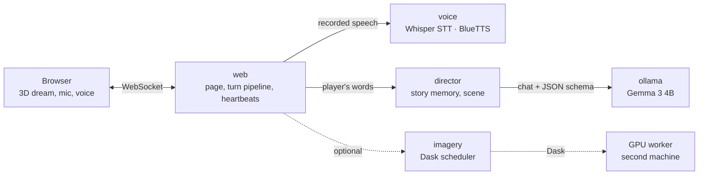

# DreamScape

A voice-driven lucid dream. You talk to a being that has just woken up in black mist and knows nothing about itself. Whatever you tell it becomes true: it becomes a fairy, the mist becomes a dark forest, it builds a spaceship, flies to the moon, finds a block of cheese… Every turn the dream grows on screen in live 3D, drawn entirely in soft particles: things gather out of the fog as glowing dust, sharpen for a moment, and drift back into haze, like a dream half remembered.

Everything runs locally on one GPU laptop, as a set of Docker containers that report their heartbeats to each other. Hebrew and English both work: speech in, speech out, and the story itself.

## How a turn works



1. You hold the glowing orb (or the space bar) and speak. The browser sends the recording to **web**.
2. **voice** transcribes it with ivrit.ai's Hebrew-tuned Whisper.
3. **director** asks the language model for one JSON answer that holds both the dreamer's spoken reply and the scene changes (new setting, things that appear, effects). Ollama's structured outputs guarantee valid JSON, and the director keeps the story's facts and the scene between turns.
4. The scene update reaches the browser at once and starts materialising while **voice** synthesises the reply with BlueTTS.
5. The dreamer speaks, and its light pulses with its voice.

### How the dream is drawn

Everything on screen is a particle cloud. The renderer knows 13 settings (void, forest, meadow, desert, ocean, mountains, cave, city, space, moon, clouds, snow, underwater) and 39 kinds of things (fairy, dragon, unicorn, castle, spaceship, cheese, portal, crystals…), each with colour, size, count, placement and motion. Each one is shaped in 3D, then sampled into thousands of soft particles. Its hard geometry is never drawn.

- **Appearing and vanishing:** particles stream in from the surrounding mist when a thing appears and scatter back when it goes. When the dreamer changes form, one cloud dissolves while the next gathers in the same place.
- **Haze:** the dream breathes between hazy and clear. In the haze, particles drift loose and shapes soften, and some dust always floats off the edges.
- **Focus:** each particle blurs by its own distance from the point of attention, like a camera lens. The lens follows whatever just appeared.
- **Pictures (with the imagery service on):** every new thing and every new form of the dreamer also gets a generated picture. The picture is sampled into its own particle cloud, which takes over from the geometric one, so the dream looks painted.

Anything outside the vocabulary appears as a shimmering apparition until its picture arrives.

## Run it

You need Docker Desktop (WSL 2 backend), an NVIDIA driver with WSL support, and about 15 GB of free disk for images and models.

```powershell
copy .env.example .env        # optional: every setting has a default
docker compose up -d --build
```

Open **http://localhost**. The first start downloads the models (Gemma 3 4B ≈ 3.3 GB, Whisper turbo ≈ 1.6 GB, and the BlueTTS bundle). The dots in the top corner show each service's heartbeat; hover for details such as download progress or tokens per second. Typing works as soon as the storyteller dot is green.

Browsers allow the microphone only on `localhost` or over HTTPS, so speak to the dream from the laptop itself; from another device on the network you can still type. Press F2 to see how long each turn took (speech-to-text, storyteller, voice).

Useful commands:

```powershell
docker compose logs -f director voice   # watch the storyteller and the voice load
docker compose ps                       # health of every container
docker compose down                     # stop (models and dreams stay in volumes)
```

### Video memory on the RTX 4070 Laptop (8 GB)

| Part | Runs on | Approx. |
|---|---|---|
| Gemma 3 4B (Q4) with a 4K context | GPU | 3.7 GB |
| Whisper large-v3-turbo, ivrit.ai, int8 | GPU | 1.5 GB |
| BlueTTS | CPU | none |
| The 3D dream in the browser | GPU | 0.3 GB |
| Background pictures | second machine | none |

That leaves headroom on 8 GB. If you already run Ollama on Windows, set `OLLAMA_URL=http://host.docker.internal:11434` in `.env` and the container uses it.

## Settings (`.env`)

| Variable | Default | What it does |
|---|---|---|
| `WEB_PORT` | `80` | Port of the dream page |
| `LLM_MODEL` | `gemma3:4b` | Any Ollama model tag; it is pulled automatically on first start |
| `STT_MODEL` | `ivrit-ai/whisper-large-v3-turbo-ct2` | Speech-to-text model (faster-whisper) |
| `STT_MODEL_EN` | empty | A second model for English, loaded on the first English utterance |
| `VOICE_NEUTRAL` | `noa,ariel` | The dreamer's voice before it has a gender (two voices averaged) |
| `VOICE_FEMALE` / `VOICE_MALE` | `maya` / `daniel` | Voices once the story gives the dreamer a gender |
| `TTS_SPEED` | `0.95` | Speaking pace |
| `COMPOSE_PROFILES` | empty | `imagery` turns on the picture service |
| `IMAGERY_URL` | empty | `http://imagery:9030` when the picture service is on |

Choose the page language at the bottom (Auto, עברית, English). In Auto the dreamer answers in whatever language you speak.

## Pictures from the second GPU machine (recommended)

The imagery service runs a Dask scheduler on the laptop. Your other GPU machine joins it as a worker and paints a picture with SD-Turbo for every new thing in the dream (plus a soft backdrop for each new place), so the laptop's video memory stays free. The page turns each picture into particles, so this is what gives the dream its painted look.

On the laptop, in `.env`:

```
COMPOSE_PROFILES=imagery
IMAGERY_URL=http://imagery:9030
```

On the second machine, copy the repository and run:

```powershell
cd worker
copy .env.example .env    # set SCHEDULER_HOST (laptop IP) and WORKER_HOST (this machine's IP)
docker compose up -d --build
```

The images dot turns green when the worker joins. Both machines build the same image, so their Dask versions always match. Port 8786 accepts work from anyone who can reach it, so keep it on your home network.

## Try it without a GPU

Scripted stand-ins for the language model, the voice and the picture painter let you run the real page and director anywhere. The stand-in painter only draws simple shapes; it shows how pictures become particles. Set `NO_PICTURES=1` to see the dream without it.

```powershell
pip install -r services/web/requirements.txt -r services/director/requirements.txt python-multipart pillow
python dev/demo.py              # then open http://localhost:8080
```

Say or type “you are a fairy in a dark forest”, “you build a spaceship and fly to the moon”, “there is a block of cheese”, “you eat it and become the god of the world”. `dev/fakes.py` lists more trigger words (dragon, castle, sea, cat, rain, snow…). `python dev/shots.py` drives that story in a headless browser and saves screenshots (first `pip install playwright` and `playwright install chromium`); `python dev/gallery.py` builds every thing and place and reports any errors.

## Project layout

```
services/
  web/        page server, WebSocket turn pipeline, heartbeat monitor
    static/js/dream/   Three.js dream: renderer, world, settings, things
  director/   game master over Ollama: prompt, JSON schema, story state (+ tests)
  voice/      faster-whisper STT and BlueTTS TTS
  imagery/    SD-Turbo pictures through Dask (one image for scheduler and worker)
worker/       compose file for the second GPU machine
dev/          GPU-free demo, fakes and screenshot script
```

Run the director's tests with `cd services/director && pip install -r requirements-dev.txt && pytest`.

## What changed from the first version

- The dream is drawn live in the browser with Three.js as soft particle clouds, with generated pictures turned into particles when the imagery service runs. The first version generated a video clip on every turn, which was the slow part.
- One language-model call per turn returns both the reply and the scene, as schema-checked JSON, with the story's facts carried between turns. TinyLlama gave way to Gemma 3 4B, which tells a coherent story in Hebrew and English.
- Speech is fully local: Whisper fine-tuned for Hebrew by ivrit.ai, and BlueTTS for Hebrew and English voices. The dreamer starts with a neutral voice and takes on a gendered one when the story decides.
- Every service reports a heartbeat; the web service gathers them and shows them on the page, and Docker health checks watch each container.
- Image generation moved to a separate, optional service that keeps the Dask route to the second machine.
- The old Google service-account key files are gone from the tree. They are still in git history and on GitHub, so delete that key in the Google Cloud console.
